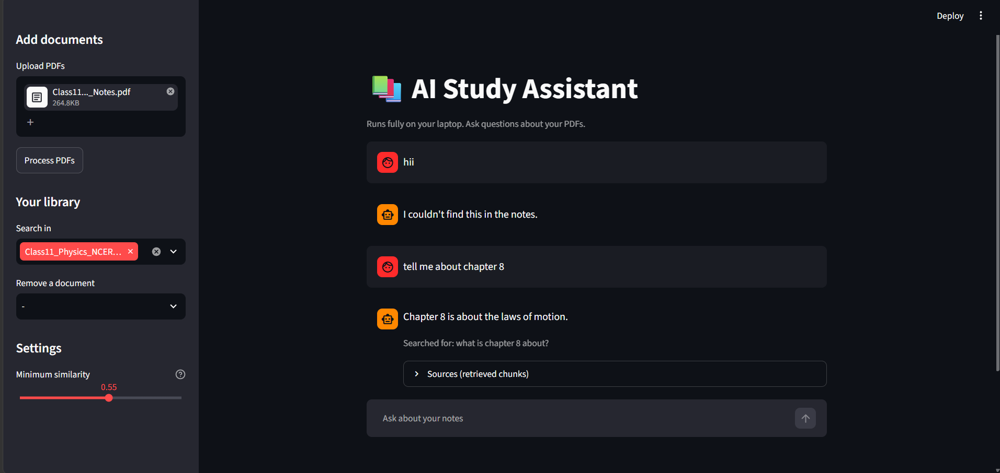
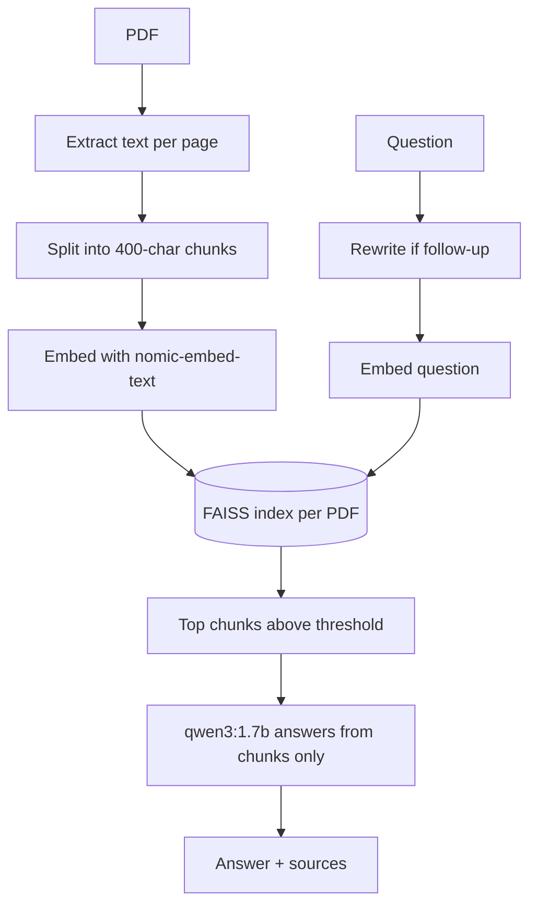

# AI Study Assistant

A fully local RAG app that answers questions about your own PDF notes, with
page-level sources. No API keys, no paid services: everything runs on your
laptop through Ollama.



## Features

- Upload multiple PDFs and search any combination of them
- Answers come only from your notes, with expandable source chunks
- Follow-up questions work (questions are rewritten using chat history)
- Refuses questions your notes don't cover, using a similarity threshold
- Runs on a 4 GB GPU laptop

## How it works



## Tech stack

Python, Streamlit, Ollama (`qwen3:1.7b`, `nomic-embed-text`), FAISS, pypdf

## Setup

1. Install [Ollama](https://ollama.com/download) and pull the models:
   ```
   ollama pull qwen3:1.7b
   ollama pull nomic-embed-text
   ```
2. Clone the repo and create a virtual environment:
   ```
   git clone [your repo URL]
   cd study-assistant
   python -m venv venv
   venv\Scripts\activate
   pip install -r requirements.txt
   ```
3. Run the app:
   ```
   streamlit run app.py
   ```
4. Upload PDFs in the sidebar, click **Process PDFs**, and start asking.

## Project structure

| File | Purpose |
|---|---|
| `pdf_chunks.py` | Reads PDFs and splits text into overlapping chunks |
| `rag_index.py` | Embeds chunks, builds FAISS indexes, searches documents |
| `rag_answer.py` | Question rewriting, prompt building, answer generation |
| `app.py` | Streamlit interface |
| `check.py` | Prints similarity scores for tuning the threshold |

## Design decisions

- **Model choice:** [your own words: why qwen3:1.7b instead of the 4B or 3B models?]
- **Chunk size:** [your own words: what did 400 vs 800 characters change?]
- **Similarity threshold:** [your own words: how did you choose 0.55?]

## Limitations

- Works with text PDFs only; scanned PDFs need OCR
- Small models can still make mistakes, which is why sources are shown
- The similarity threshold should be rechecked for new kinds of documents

## Future work

[your ideas: OCR support, hybrid keyword search, evaluation set, ...]